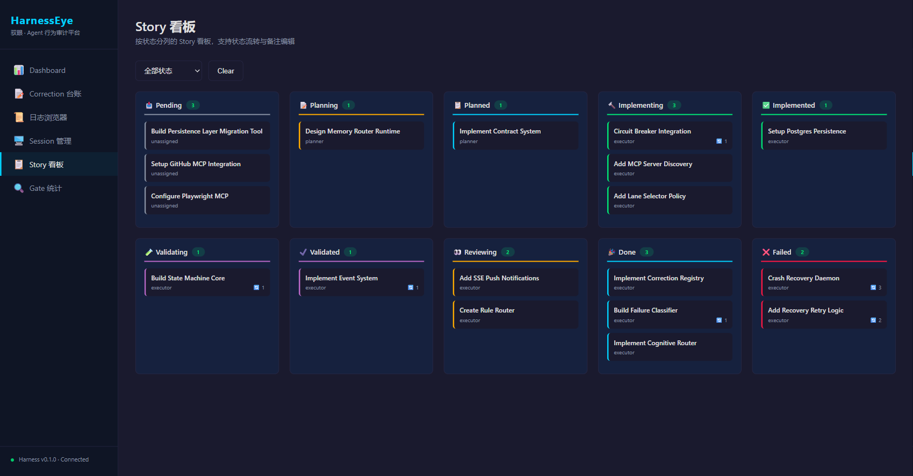
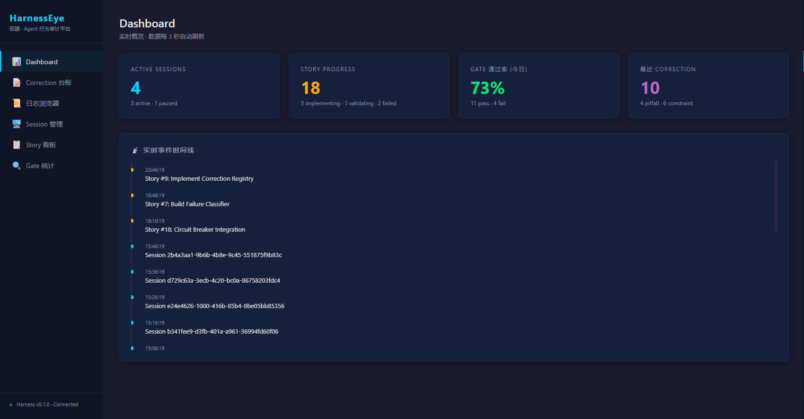
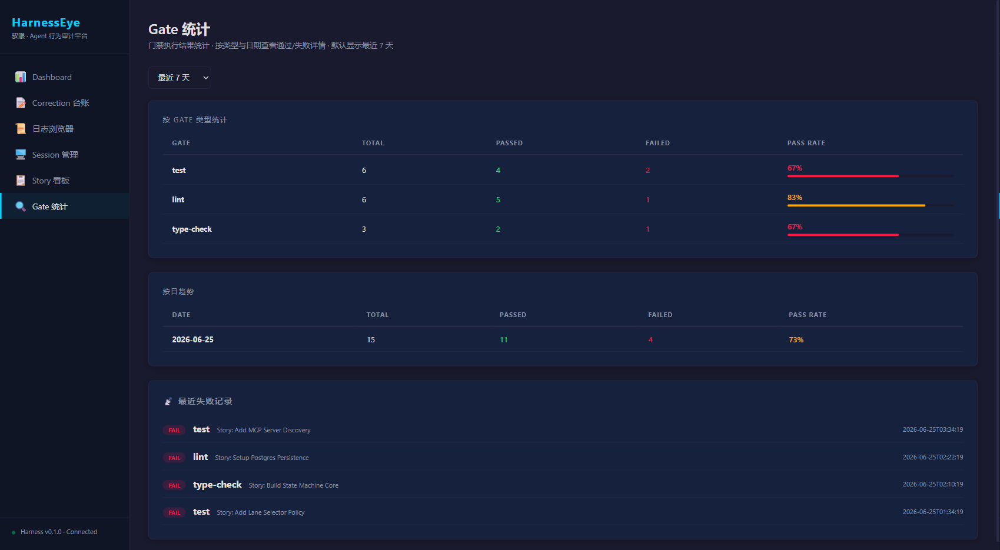
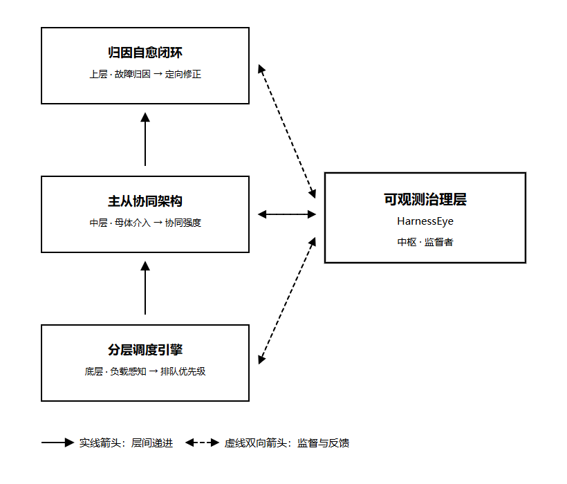
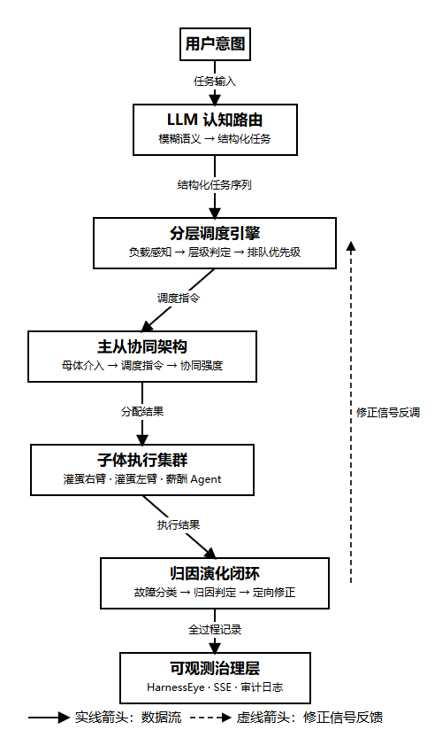

# Harness Engineer · 多智能体自适应治理与归因自愈框架

> **Agent = Model + Harness**
> 模型决定上限，Harness 决定下限。

面向 AI Agent「失控、不可审计、无法恢复」三大痛点，构建**确定性、可审计、可恢复**的智能体工程化管控系统。

> 本项目为本科毕业设计《基于 Harness 的多智能体自适应治理与归因自愈框架》的核心引擎实现。

## ⚠️ 项目状态

**毕业设计仍在进行中**（2026.03 起，预计 2027.06 完成）。本仓库是**阶段性成果**，不是完成品。

**已完成（本仓库内容）**

- [x] 架构设计定稿（`ARCHITECTURE.md` v2）
- [x] 控制面：12 状态机、4 角色 tool-level 权限隔离、5 级 Lane 决策
- [x] 恢复层：事件系统、失败分类、重试策略、回滚计划
- [x] 规则层：Rule Schema + 4 类规则自动分类路由
- [x] 持久化层：PostgreSQL 5 表结构
- [x] **HarnessEye** 行为审计平台 v1.1（10000+ 行、104 项测试、6 页面、16 API）— 代码未包含在本仓库，见下方截图

**进行中 / 规划中**

- [ ] 部署层实例化（agents / skills / context / hooks）
- [ ] 真实项目 Lane 2 PIV 实战验证
- [ ] 具身智能 ↔ 企业计算 双场景跨域验证

---

## HarnessEye · Agent 行为审计平台

框架的可视化前端（独立应用，代码不包含在本仓库）。

**Story 看板** —— 12 状态流转 + 角色分工的可视化：



**实时 Dashboard** —— 会话数、Story 进度、Gate 通过率、事件时间线：



**Gate 统计** —— 门禁执行结果的通过/失败趋势：



---

## 核心问题

当前多智能体系统普遍存在：

| 问题 | 表现 |
|:---|:---|
| **失控** | Agent 越权操作、擅自扩大改动范围、绕过评审直接改代码 |
| **不可审计** | 执行过程无留痕，出了问题无法回溯是哪一步、哪个角色导致 |
| **不可恢复** | 失败后只能重跑，没有分类、重试策略与回滚计划 |

本框架用**结构约束**而非提示词约束来解决——把治理写进代码，而不是写在提示里。

---

## 系统架构





---

## 核心设计

### 1. 五级执行通道（Lane）

按任务风险与范围**确定性地**选择执行路径，避免所有任务都走重型流程，也避免高风险任务走轻流程。

| Lane | 名称 | 触发条件 | 典型耗时 |
|:---|:---|:---|:---|
| 0 | Direct Execute | ≤2 文件、明确 hotfix、风险分 <3 | < 5 分钟 |
| 1 | Explore / Map | 仓库结构不明确、范围模糊 | — |
| 2 | Full PIV | 默认通道（Plan→Implement→Validate→Review） | — |
| 3 | Parallel | 可拆分的独立子问题 | — |
| 4 | Strict Verify | 高风险、需持续验证 | — |

### 2. 状态机（唯一流转入口）

所有状态变更必须经过状态机，非法流转直接拒绝。共 **12 个 Story 状态**：

```
pending → planning → planned → implementing → implemented
       → validating → validated → reviewing → done
                        ↘ rejected / failed → retrying
```

### 3. 角色级工具权限隔离

**不是靠提示词说"你别改"，而是在工具调用层直接拒绝。**

四个角色，权限硬隔离：

| 角色 | 职责 | 关键约束 |
|:---|:---|:---|
| `planner` | 只做方案 | 不能写代码 |
| `executor` | 只做实现 | 不能扩大范围 |
| `reviewer` | 只审 diff | 不能改代码、不能 mcp write |
| `verifier` | 只验结果 | 不能偷偷改 |

### 4. 失败恢复链路

```
failure_classifier → retry_policy → rollback_plan
```

失败先**分类**（哪一类失败），再决定**重试策略**（重试几次、退避多少），最后给出**回滚计划**（回滚到哪个安全点）。

### 5. 认知路由与规则路由

- **认知路由**（CR-001 ~ CR-005）：意图 → 转换 → 检索 → 模式 → 沉淀
- **规则路由**：新规则按类别自动归档，规则是**踩出来的**，不是事前拍脑袋定义的

---

## 目录结构

```
harness-multi-agent/
├── ARCHITECTURE.md              # 完整架构设计文档
├── CONTEXT.md                   # 领域术语表
├── workflow_engine/             # 核心引擎
│   ├── state_machine.py         # 12 状态机（唯一流转入口）
│   ├── contract.py              # 4 角色 tool-level 权限隔离
│   ├── lanes.py                 # 5 级 Lane 定义
│   ├── cognitive_router.py      # 认知路由层（CR-001~005）
│   ├── events.py                # 事件系统 + 审计 JSONL
│   ├── rule_schema.py           # 规则模式
│   ├── rule_router.py           # 规则自动归档
│   ├── policy/
│   │   └── lane_selector.py     # 确定性 Lane 决策
│   └── recovery/
│       ├── failure_classifier.py
│       ├── retry_policy.py
│       └── rollback_plan.py
├── persistence/
│   ├── schema.sql               # PostgreSQL 持久化表结构
│   └── auto_save.py
└── docs/
    ├── framework.png            # 四层框架图
    ├── roadmap.png              # 技术路线图
    └── screenshots/             # HarnessEye 界面截图
        ├── dashboard.png
        ├── story-board.png
        └── gate-stats.png
```

核心引擎约 **3000 行 Python**。

---

## 快速开始

```bash
git clone https://github.com/cckslv/harness-multi-agent.git
cd harness-multi-agent

# 核心模块无外部依赖，可直接导入
python -c "from workflow_engine import state_machine, contract, lanes; print('ok')"

# 持久化层需要 PostgreSQL
psql -f persistence/schema.sql
```

---

## 设计原则

1. **结构约束优先于提示词约束** —— 权限、状态、通道都在代码层强制执行
2. **规则是踩出来的** —— 初始规则表为空，每次真实失误后追加一条
3. **一切可审计** —— 状态流转、工具调用、规则变更全部留痕
4. **失败可分类、可重试、可回滚** —— 不把失败当异常，当作一等公民处理

---

## 参考

设计过程中参考了以下开源实践：

- `coleam00/harness-engineering-demo` — PIV 循环 + Hook 自动化
- `watsonctl/agent-harness` — 纠错注册表 + Session 协议 + Execution Lanes
- `MattMagg/agent-harness` — 原则 + 跨域不变量
- `jonzarecki/harness-engineering-skill` — Skill 驱动 + Verification Loops

---

## License

本项目仅供学习与学术交流使用。
